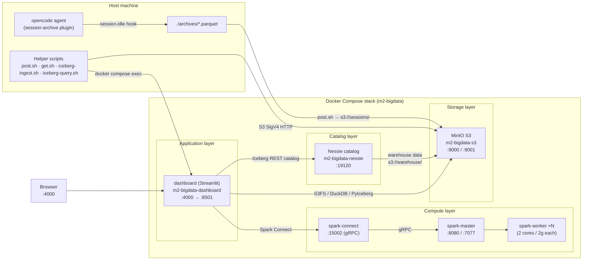
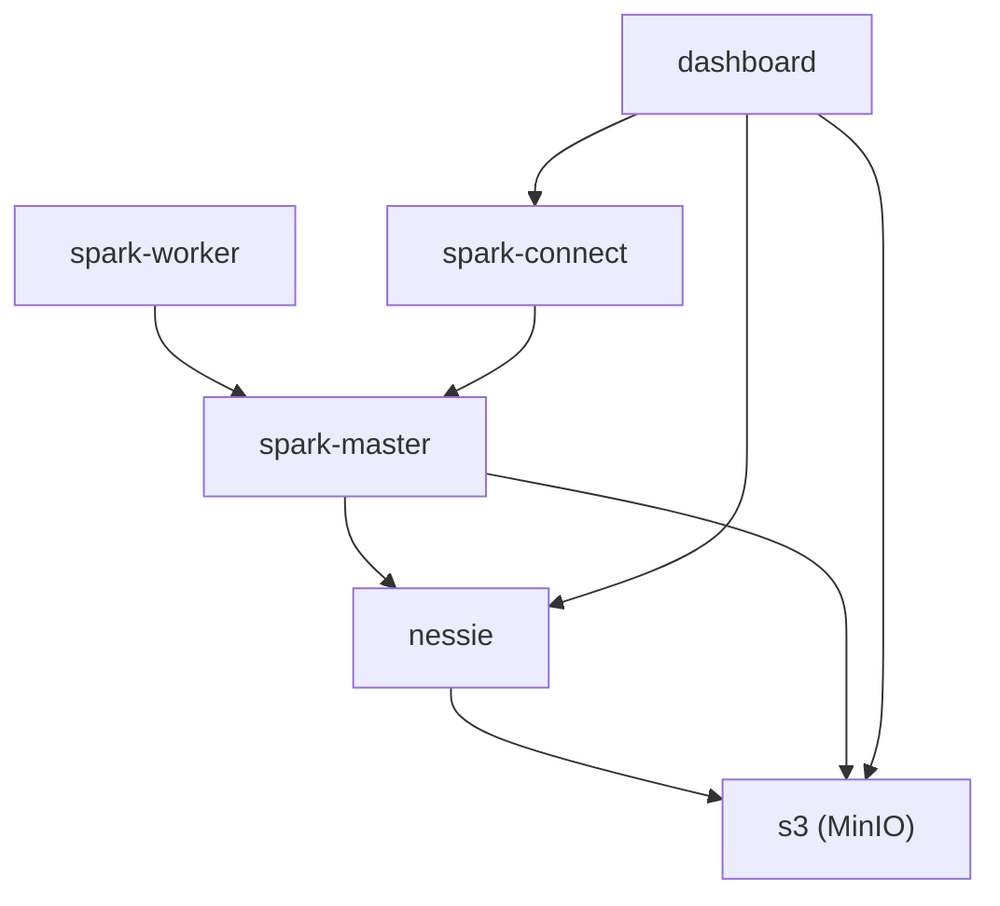
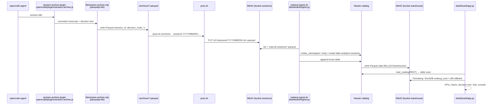
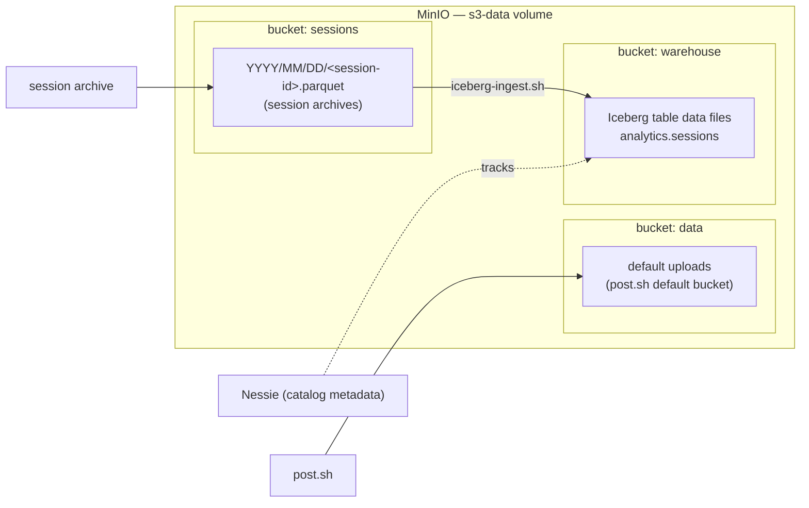
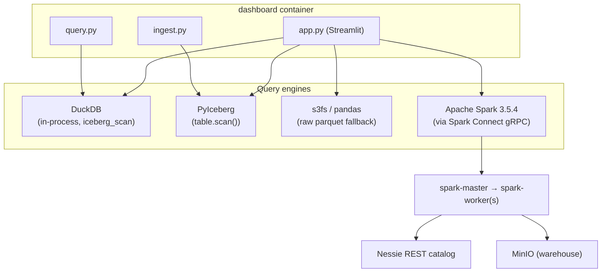
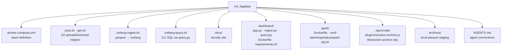

# Project Architecture

Local big-data playground built around a Dockerized MinIO S3 server, an Iceberg lakehouse (Nessie catalog), a standalone Apache Spark cluster, and a Streamlit dashboard. Session archives (Parquet) flow automatically from the opencode agent into MinIO, get ingested into an Iceberg table, and are visualized/queried from the dashboard.

---

## High-level overview

---

## Docker services (from `docker-compose.yml`)

| Service | Image / Build | Container | Host ports | Role |
|---|---|---|---|---|
| `s3` | `quay.io/minio/minio:latest` | `m2-bigdata-s3` | `9000`, `9001` | Object storage (S3 API + console) |
| `nessie` | `ghcr.io/projectnessie/nessie:latest` | `m2-bigdata-nessie` | `19120` | Iceberg REST catalog (RocksDB store) |
| `dashboard` | `./dashboard` | `m2-bigdata-dashboard` | `4000 → 8501` | Streamlit UI + ingest/query scripts |
| `spark-master` | `./spark` | `m2-bigdata-spark-master` | `8080`, `7077` | Spark standalone master |
| `spark-worker` | `./spark` | (scaled, default 1; `start.sh` uses 3) | — | Spark workers (2 cores / 2 GB) |
| `spark-connect` | `./spark` | `m2-bigdata-spark-connect` | `15002` | Spark Connect gRPC server |

Shared environment anchor (`x-spark-env`): `ICEBERG_VERSION=1.11.0`, `AWS_REGION=us-east-1`.

Volumes: `s3-data` (MinIO objects), `nessie-data` (catalog metadata).

### Dependency graph

---

## Data flow: session archival → lakehouse → dashboard

---

## Storage layout (MinIO buckets)

Rules: session archives always go to the `sessions` bucket with date-partitioned keys (`YYYY/MM/DD/<session-id>.parquet`); never to `data`. The `warehouse` bucket is owned by the Iceberg/Nessie layer.

---

## Query engines

- **DuckDB** — ad-hoc SQL over `iceberg_scan('<table location>')` (default engine in the SQL console).
- **PyIceberg** — catalog metadata + Arrow scans (dashboard KPIs, `ingest.py`).
- **Spark Connect** — optional distributed engine (`./spark/start.sh`), catalog `iceberg` = Nessie REST.
- **s3fs** — fallback raw-Parquet reader when no Iceberg table exists yet.

---

## Repository structure

---

## Technology stack summary

| Layer | Technology |
|---|---|
| Object storage | MinIO (S3-compatible, SigV4, path-style, `us-east-1`) |
| Table format | Apache Iceberg 1.11.0 |
| Catalog | Project Nessie (REST, RocksDB) |
| Batch/SQL compute | Apache Spark 3.5.4 (standalone, Java 17) |
| Remote compute API | Spark Connect (gRPC :15002) |
| In-process SQL | DuckDB |
| Dashboard | Streamlit + Plotly + pandas |
| Archival pipeline | opencode plugin → parquetjs-lite → post.sh |
| Docs | Docsify (`docs/index.html`) |

---

## Exposed endpoints

| URL | Service |
|---|---|
| `http://localhost:4000` | Streamlit dashboard |
| `http://localhost:9000` | MinIO S3 API |
| `http://localhost:9001` | MinIO console (`root` / `root-134`) |
| `http://localhost:19120` | Nessie REST catalog |
| `http://localhost:8080` | Spark master UI |
| `spark://localhost:7077` | Spark master |
| `grpc://localhost:15002` | Spark Connect |
