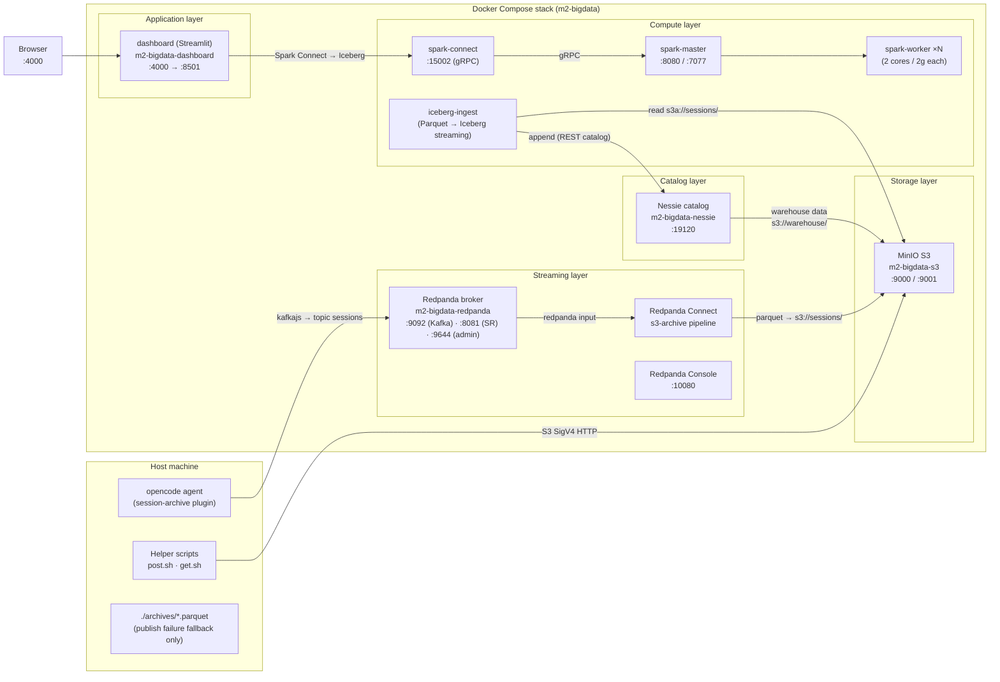
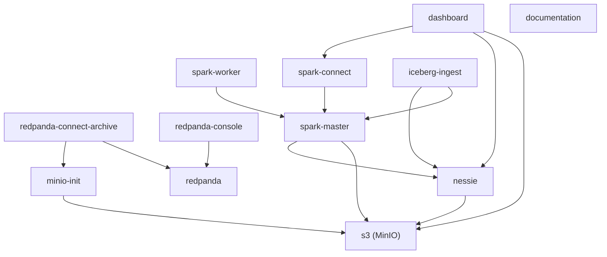
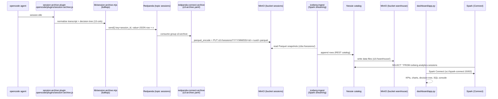
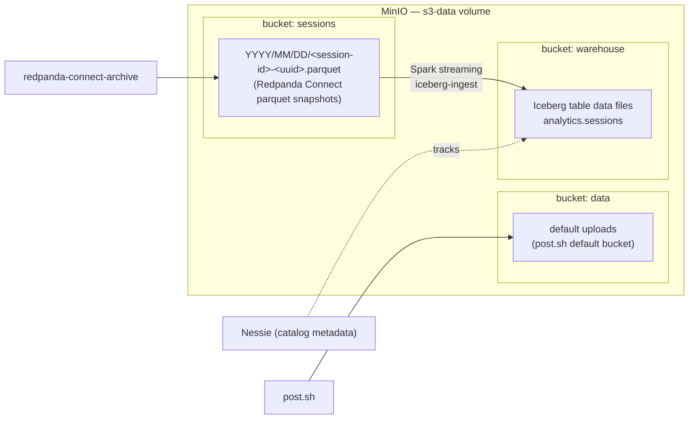
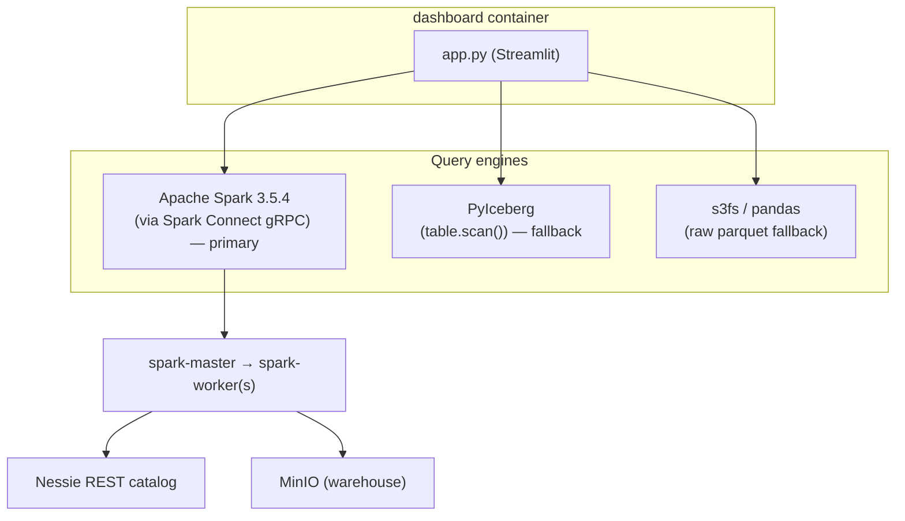
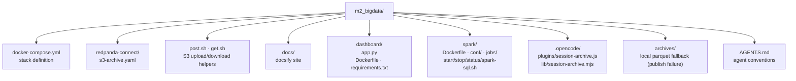

# Project Architecture

Local big-data playground built around a Dockerized MinIO S3 server, Redpanda streaming, an Iceberg lakehouse (Nessie catalog), a standalone Apache Spark cluster, and a Streamlit dashboard. Session archives flow automatically from the opencode agent into Redpanda (topic `sessions`); Redpanda Connect persists them as Parquet snapshots in MinIO `sessions`; a Spark structured-streaming job (`iceberg-ingest`) ingests those snapshots into the Iceberg lakehouse (Nessie catalog); and the dashboard reads Iceberg via Spark for visualization and SQL.

---

## High-level overview

---

## Docker services (from `docker-compose.yml`)

| Service | Image / Build | Container | Host ports | Role |
|---|---|---|---|---|
| `s3` | `quay.io/minio/minio:latest` | `m2-bigdata-s3` | `9000`, `9001` | Object storage (S3 API + console) |
| `nessie` | `ghcr.io/projectnessie/nessie:latest` | `m2-bigdata-nessie` | `19120` | Iceberg REST catalog (RocksDB store) |
| `minio-init` | `quay.io/minio/minio:latest` | `m2-bigdata-minio-init` | — | One-shot bucket creation (`data`, `sessions`, `warehouse`) |
| `redpanda` | `docker.redpanda.com/redpandadata/redpanda:v26.2.2` | `m2-bigdata-redpanda` | `9092`, `8081`, `9644` | Kafka-compatible stream broker |
| `redpanda-console` | `docker.redpanda.com/redpandadata/console:v3.11.0` | `m2-bigdata-redpanda-console` | `10080` | Redpanda web UI |
| `redpanda-connect-archive` | `./redpanda-connect` | `m2-bigdata-redpanda-connect-archive` | — | Topic `sessions` → Parquet snapshots in MinIO `sessions` (10s batching) |
| `iceberg-ingest` | `./spark` | `m2-bigdata-iceberg-ingest` | — | Spark streaming: Parquet `s3a://sessions/` → Iceberg `analytics.sessions` (10s trigger) |
| `dashboard` | `./dashboard` | `m2-bigdata-dashboard` | `4000 → 8501` | Streamlit UI + query scripts |
| `spark-master` | `./spark` | `m2-bigdata-spark-master` | `8080`, `7077` | Spark standalone master |
| `spark-worker` | `./spark` | (scaled, default 1; `start.sh` uses 3) | — | Spark workers (2 cores / 2 GB) |
| `spark-connect` | `./spark` | `m2-bigdata-spark-connect` | `15002` | Spark Connect gRPC server |
| `documentation` | `./docs` | `m2_bigdata-documentation-1` | `2000 → 80` | Docsify documentation site (nginx) |

Shared environment anchor (`x-spark-env`): `ICEBERG_VERSION=1.11.0`, `AWS_REGION=us-east-1`.

Volumes: `s3-data` (MinIO objects), `nessie-data` (catalog metadata), `redpanda-data` (topics/logs).

### Dependency graph

---

## Data flow: session archival → lakehouse → dashboard

---

## Storage layout (MinIO buckets)

Rules: session archives always go to the `sessions` bucket with date-partitioned keys; never to `data`. The `warehouse` bucket is owned by the Iceberg/Nessie layer. The live Iceberg table is written by the `iceberg-ingest` Spark streaming job, not by a batch script.

---

## Query engines

- **Spark Connect** — primary engine for the dashboard, reads `iceberg.analytics.sessions` (catalog `iceberg` = Nessie REST). Needs `./spark/start.sh`.
- **PyIceberg** — fallback once the table exists and Spark is down.
- **s3fs** — last-resort raw-Parquet reader when no Iceberg table exists yet.

---

## Repository structure

---

## Technology stack summary

| Layer | Technology |
|---|---|
| Object storage | MinIO (S3-compatible, SigV4, path-style, `us-east-1`) |
| Stream broker | Redpanda 26.2 (Kafka API-compatible) |
| Connect / streaming ETL | Redpanda Connect 4.x (s3 parquet archive sink) |
| Table format | Apache Iceberg 1.11.0 |
| Catalog | Project Nessie (REST, RocksDB) |
| Batch/SQL compute | Apache Spark 3.5.4 (standalone, Java 17) |
| Iceberg ingestion | Spark structured streaming (`iceberg-ingest`: Parquet → Iceberg) |
| Remote compute API | Spark Connect (gRPC :15002) |
| Dashboard | Streamlit + Plotly + pandas |
| Archival pipeline | opencode plugin → kafkajs → Redpanda → Redpanda Connect → Spark |
| Docs | Docsify (`docs/index.html`) |

---

## Exposed endpoints

| URL | Service |
|---|---|
| `http://localhost:4000` | Streamlit dashboard |
| `http://localhost:2000` | Documentation site (docsify) |
| `http://localhost:9000` | MinIO S3 API |
| `http://localhost:9001` | MinIO console (`root` / `root-134`) |
| `http://localhost:10080` | Redpanda Console |
| `http://localhost:19120` | Nessie REST catalog |
| `http://localhost:9092` | Redpanda Kafka API (internal) |
| `http://localhost:9093` | Redpanda Kafka API (external-advertised) |
| `http://localhost:8081` | Redpanda Schema Registry |
| `http://localhost:9644` | Redpanda Admin API |
| `http://localhost:8080` | Spark master UI |
| `spark://localhost:7077` | Spark master |
| `sc://localhost:15002` | Spark Connect |
