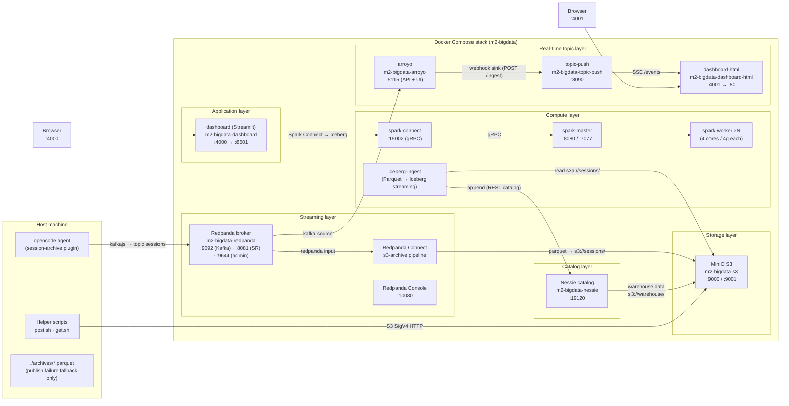
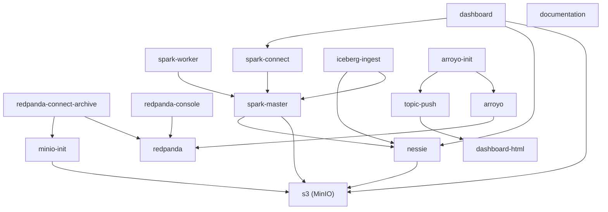
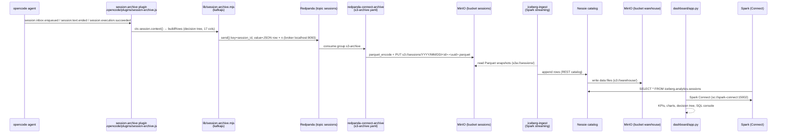
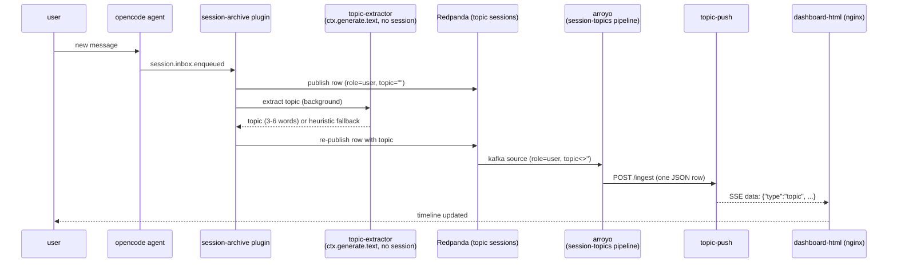
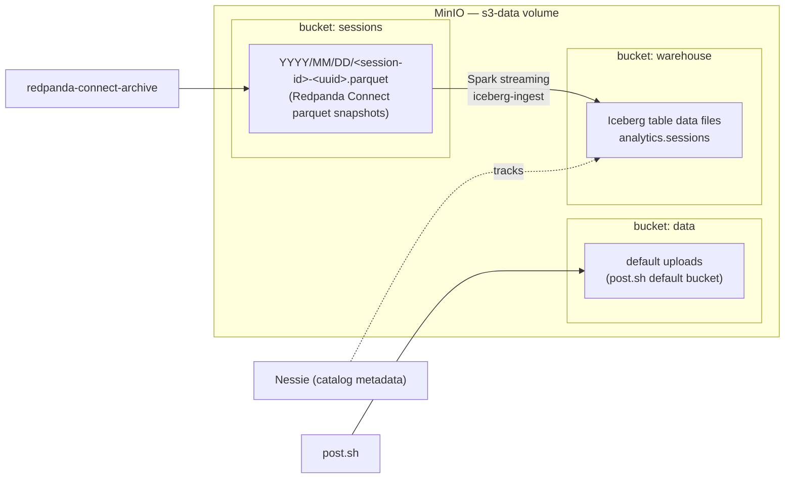
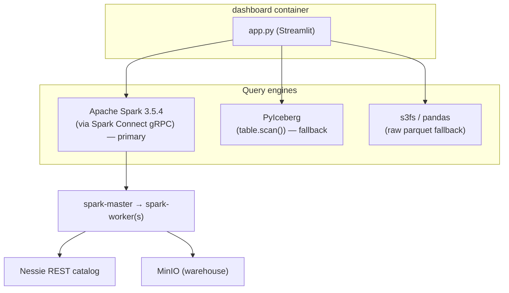

# Project Architecture

Local big-data playground built around a Dockerized MinIO S3 server, Redpanda streaming, an Iceberg lakehouse (Nessie catalog), a standalone Apache Spark cluster, and a Streamlit dashboard. Session archives flow automatically from the opencode agent into Redpanda (topic `sessions`); Redpanda Connect persists them as Parquet snapshots in MinIO `sessions`; a Spark structured-streaming job (`iceberg-ingest`) ingests those snapshots into the Iceberg lakehouse (Nessie catalog); and the dashboard reads Iceberg via Spark for visualization and SQL.

---

## High-level overview

---

## Docker services (from `docker-compose.yml`)

| Service | Image / Build | Container | Host ports | Role |
|---|---|---|---|---|
| `s3` | `quay.io/minio/minio:latest` | `m2-bigdata-s3` | `9000`, `9001` | Object storage (S3 API + console) |
| `nessie` | `ghcr.io/projectnessie/nessie:latest` | `m2-bigdata-nessie` | `19120` | Iceberg REST catalog (RocksDB store) |
| `minio-init` | `quay.io/minio/minio:latest` | `m2-bigdata-minio-init` | — | One-shot bucket creation (`data`, `sessions`, `warehouse`) |
| `redpanda` | `docker.redpanda.com/redpandadata/redpanda:v26.2.2` | `m2-bigdata-redpanda` | `9092`, `9093`, `8081`, `9644` | Kafka-compatible stream broker |
| `redpanda-console` | `docker.redpanda.com/redpandadata/console:v3.11.0` | `m2-bigdata-redpanda-console` | `10080` | Redpanda web UI |
| `redpanda-connect-archive` | `./redpanda-connect` | `m2-bigdata-redpanda-connect-archive` | — | Topic `sessions` → Parquet snapshots in MinIO `sessions` (2000 rows / 15 s batches, zstd) |
| `topic-push` | `./topic-push` | `m2-bigdata-topic-push` | `8090` | In-memory topic buffer + SSE fan-out (`POST /ingest`, `GET /events`) |
| `arroyo` | `ghcr.io/arroyosystems/arroyo:latest` (built by `./arroyo`) | `m2-bigdata-arroyo` | `5115` | Stream engine (SQL): Kafka `sessions` → webhook push |
| `arroyo-init` | `./arroyo` | `m2-bigdata-arroyo-init` | — | One-shot registration of the `session-topics` pipeline via the Arroyo API |
| `dashboard-html` | `./dashboard-html` | `m2-bigdata-dashboard-html` | `4001 → 80` | Static HTML dashboard (nginx) + SSE proxy to `topic-push` |
| `iceberg-ingest` | `./spark` | `m2-bigdata-iceberg-ingest` | — | Spark streaming: Parquet `s3a://sessions/` → Iceberg `analytics.sessions` (10 s trigger, table partitioned by day) |
| `iceberg-maintenance` | `./spark` | `m2-bigdata-iceberg-maintenance` | — | Compaction of `analytics.sessions` every 30 min (`rewrite_data_files`, `local[1]`) |
| `dashboard` | `./dashboard` | `m2-bigdata-dashboard` | `4000 → 8501` | Streamlit UI + query scripts |
| `spark-master` | `./spark` | `m2-bigdata-spark-master` | `8080`, `7077` | Spark standalone master |
| `spark-worker` | `./spark` | (scaled, default 1; `start.sh` uses 3) | — | Spark workers (4 cores / 4 GB each) |
| `spark-connect` | `./spark` | `m2-bigdata-spark-connect` | `15002` | Spark Connect gRPC server |
| `documentation` | `./docs` | `m2_bigdata-documentation-1` | `2000 → 80` | Docsify documentation site (nginx) |

Shared environment anchor (`x-spark-env`): `ICEBERG_VERSION=1.11.0`, `AWS_REGION=us-east-1`.

Volumes: `s3-data` (MinIO objects), `nessie-data` (catalog metadata), `redpanda-data` (topics/logs), `arroyo-data` (Arroyo sqlite catalog, checkpoints, compiled artifacts).

### Dependency graph

---

## Data flow: session archival → lakehouse → dashboard

---

## Data flow: topic extraction → real-time dashboard

Key points:

- The plugin publishes the archive **live** (debounce 250 ms) — no need to wait for the session to end; a final flush runs on `session.execution.succeeded`.
- Topic extraction calls `ctx.generate.text({ model, prompt })`: **no opencode session is created**, no tool runs, nothing is added to any history — there is no recursion risk and no internal session to hide from the archive.
- The session model is attempted first. When its provider rejects transient calls (the `opencode` free tier does), the extractor falls back to models from `ctx.model.list()` (three attempts max) and remembers the working one; otherwise it uses the heuristic.
- Topics are cached per session under `ord:<n>` (rank of the user message) and `txt:<sha1>` (text fingerprint), so a shifted message index does not lose the subject.
- Compaction drops the `user` messages from `ctx.session.context()`. The plugin keeps every prompt seen on `session.inbox.enqueued` and re-injects the missing ones as root `user` rows, so a compacted session still produces its subjects.
- The topic column lives in the same row as the archived message, so it is also persisted to Parquet and Iceberg.
- `arroyo/pipeline.sql` is the single source of truth for the stream definition; `arroyo/init.sh` registers it idempotently through the Arroyo REST API (`POST /api/v1/pipelines`).
- `topic-push` keeps the last 500 topics per session in memory and fans them out over SSE; `dashboard-html` proxies `/events` without buffering.

See [Real-time dashboard](/real-time-dashboard.md) for the UI anatomy, the SSE
contract, the full `topic-push` API and the troubleshooting guide.

---

## Storage layout (MinIO buckets)

Rules: session archives always go to the `sessions` bucket with date-partitioned keys; never to `data`. The `warehouse` bucket is owned by the Iceberg/Nessie layer. The live Iceberg table is written by the `iceberg-ingest` Spark streaming job, not by a batch script.

---

## Query engines

- **Spark Connect** — primary engine for the dashboard, reads `iceberg.analytics.sessions` (catalog `iceberg` = Nessie REST). Needs `./spark/start.sh`.
- **PyIceberg** — fallback once the table exists and Spark is down.
- **s3fs** — last-resort raw-Parquet reader when no Iceberg table exists yet.

---

## Repository structure

```mermaid
flowchart TD
    ROOT["m2_bigdata/"]
    DC["docker-compose.yml<br/>stack definition"]
    RPCF["redpanda-connect/<br/>s3-archive.yaml"]
    P1["post.sh · get.sh<br/>S3 upload/download helpers"]
    DOCS["docs/<br/>docsify site"]
    DASHF["dashboard/<br/>app.py<br/>Dockerfile · requirements.txt"]
    SPARKF["spark/<br/>Dockerfile · conf/ · jobs/<br/>start/stop/status/spark-sql.sh"]
    ARRF["arroyo/<br/>Dockerfile · pipeline.sql · init.sh"]
    TPF["topic-push/<br/>Dockerfile · server.js"]
    DHTMLF["dashboard-html/<br/>Dockerfile · nginx.conf · index.html"]
    OPP[".opencode/<br/>plugins/session-archive.js<br/>lib/session-archive.mjs<br/>lib/topic-extractor.mjs"]
    ARC["archives/<br/>local parquet fallback (publish failure)"]
    AG["AGENTS.md<br/>agent conventions"]

    ROOT --> DC
    ROOT --> RPCF
    ROOT --> P1
    ROOT --> DOCS
    ROOT --> DASHF
    ROOT --> SPARKF
    ROOT --> ARRF
    ROOT --> TPF
    ROOT --> DHTMLF
    ROOT --> OPP
    ROOT --> ARC
    ROOT --> AG
```

---

## Technology stack summary

| Layer | Technology |
|---|---|
| Object storage | MinIO (S3-compatible, SigV4, path-style, `us-east-1`) |
| Stream broker | Redpanda 26.2 (Kafka API-compatible) |
| Connect / streaming ETL | Redpanda Connect 4.111 (s3 parquet archive sink) |
| Stream processing (real-time) | Arroyo 0.15 (SQL streaming engine, Kafka source + webhook sink) |
| Real-time transport | Server-Sent Events (`topic-push`, zero-dependency Node service) |
| Table format | Apache Iceberg 1.11.0 |
| Catalog | Project Nessie (REST, RocksDB) |
| Batch/SQL compute | Apache Spark 3.5.4 (standalone, Java 17) |
| Iceberg ingestion | Spark structured streaming (`iceberg-ingest`: Parquet → Iceberg) |
| Remote compute API | Spark Connect (gRPC :15002) |
| Dashboard | Streamlit + Plotly + pandas |
| Archival pipeline | opencode plugin → kafkajs → Redpanda → Redpanda Connect → Spark |
| Docs | Docsify (`docs/index.html`) |

---

## Exposed endpoints

| URL | Service |
|---|---|
| `http://localhost:4000` | Streamlit dashboard |
| `http://localhost:4001` | Real-time topic dashboard (HTML + SSE) |
| `http://localhost:5115` | Arroyo web UI / REST API |
| `http://localhost:8090` | topic-push API (`/healthz`, `/sessions`, `/events`) |
| `http://localhost:2000` | Documentation site (docsify) |
| `http://localhost:9000` | MinIO S3 API |
| `http://localhost:9001` | MinIO console (`root` / `root-134`) |
| `http://localhost:10080` | Redpanda Console |
| `http://localhost:19120` | Nessie REST catalog |
| `http://localhost:9092` | Redpanda Kafka API (annonce `redpanda:9092` — réseau Docker uniquement) |
| `http://localhost:9093` | Redpanda Kafka API, listener `EXTERNAL` (annonce `localhost:9093`) — **clients hôte (plugin opencode)** |
| `http://localhost:8081` | Redpanda Schema Registry |
| `http://localhost:9644` | Redpanda Admin API |
| `http://localhost:8080` | Spark master UI |
| `spark://localhost:7077` | Spark master |
| `sc://localhost:15002` | Spark Connect |
