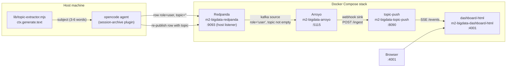

# Real-time topic dashboard

A single-file HTML dashboard that displays, live, the subject of every user
message in an opencode session.

**URL:** <http://localhost:4001>

It answers one question: *what was this session about, turn after turn?* Each
user prompt is summarised by an LLM into a 3–6 word French subject, pushed
through the streaming stack and drawn on a timeline within a couple of seconds.

```text
opencode plugin (host)
  → Redpanda topic `sessions`
  → Arroyo pipeline `session-topics`
  → topic-push (POST /ingest, in-memory buffer)
  → dashboard-html (nginx, SSE proxy)
```

This is **not** the Streamlit dashboard. See
[the difference between the two dashboards](#two-dashboards) below.

---

## Where it sits in the stack



| Path | Role |
|---|---|
| `.opencode/plugins/session-archive.js` | Publishes archive rows live, triggers subject extraction, republishes the row once the subject is known |
| `.opencode/lib/topic-extractor.mjs` | LLM subject extraction (`ctx.generate.text`), with model fallback chain and heuristic fallback |
| `arroyo/pipeline.sql` | Stream definition: Kafka source → filter → webhook sink |
| `arroyo/init.sh` | Idempotent registration of the pipeline through the Arroyo REST API |
| `topic-push/server.js` | In-memory buffer, dedupe, pruning, `POST /ingest`, `GET /events` (SSE), `GET /sessions`, `GET /healthz` |
| `dashboard-html/index.html` | The whole UI: one HTML file, no build step, no framework, no CDN |
| `dashboard-html/nginx.conf` | Serves the page and proxies `/events`, `/sessions`, `/healthz` without buffering |

---

## Using the dashboard

The page opens on the most recently active session and updates by itself.

| Area | What it shows |
|---|---|
| Status pill (top left) | `live` when the SSE stream is open, `reconnexion…` while it retries |
| Session selector | One entry per session seen by `topic-push`, newest first, with its subject count |
| `<n> sujets` | Number of subjects (user turns) in the selected session |
| `durée` | Time between the first and the last subject of the session |
| Timeline (main panel) | One dot per subject, positioned on a time axis; labels alternate above and below the axis |
| Detail (right panel) | Selected subject, its timestamp, its turn number (`message_index`), the session id and the beginning of the prompt |
| Subjects (right panel) | Flat list of the same subjects, `#1`, `#2`, … in turn order |

Interactions:

- **Click a dot or a list entry** to load that subject in the detail panel.
- **Change the session** in the selector to go back in time; the timeline follows the selected session, not the newest event.
- New events arriving while a session is selected keep the selection.
- Until you pick a session, the page follows the newest activity: a new subject switches the view to its session and scrolls the timeline to the right. Choosing a session in the selector stops that.
- Subjects are ordered by `message_index` (turn order), not by wall-clock time, so a late or republished row never reorders the story.

---

## The SSE contract

`GET /events` (proxied as `http://localhost:4001/events`) is a
`text/event-stream`. It starts with `retry: 2000`, then sends three kinds of
frames.

**1. One `snapshot` frame** — the whole current buffer, so a page reload or a
second browser tab is instantly consistent:

```json
{
  "type": "snapshot",
  "sessions": [
    {
      "session_id": "20261021-152825-a926b56e8ac8",
      "first_seen": "2026-10-21T13:42:51.000Z",
      "last_seen": "2026-10-21T14:03:58.000Z",
      "events": [
        {
          "session_id": "20261021-152825-a926b56e8ac8",
          "timestamp": "2026-10-21T13:42:51.000Z",
          "topic": "confirmation de fin de tâche",
          "message_index": 40,
          "decision_node_id": 40,
          "content": "ok c'est fait",
          "received_at": "2026-10-21T14:03:58.552Z"
        }
      ]
    }
  ]
}
```

**2. One `topic` frame per accepted row:**

```json
{
  "type": "topic",
  "event": {
    "session_id": "20261021-152825-a926b56e8ac8",
    "timestamp": "2026-10-21T14:03:58.000Z",
    "topic": "confirmation de fin de tâche",
    "message_index": 70,
    "decision_node_id": 70,
    "content": "ok c'est fait",
    "received_at": "2026-10-21T14:03:58.900Z"
  }
}
```

**3. A `: ping` comment every 15 s**, which keeps proxies and browsers from
dropping an idle connection.

Sessions in the snapshot are sorted by `last_seen` descending. Events are sorted
by `message_index` ascending.

---

## topic-push HTTP API

Exposed on `:8090`. nginx also proxies `/events`, `/sessions` and `/healthz`
through `:4001`, so the dashboard origin can be used for read-only checks;
`/ingest` is only reachable on `:8090` (inside the Docker network).

| Method | Path | Purpose | Response |
|---|---|---|---|
| `POST` | `/ingest` | Append rows (Arroyo webhook sink) | `202 {"accepted": n, "received": m}` |
| `GET` | `/events` | SSE stream (snapshot + live frames) | `text/event-stream` |
| `GET` | `/sessions` | Full buffer as JSON (debugging) | `200 {"sessions": [...]}` |
| `GET` | `/healthz` | Liveness + counters | `200 {"ok": true, "sessions": 3, "clients": 1}` |

### `POST /ingest`

Accepts, in any of these shapes:

- a single row object;
- an array of rows;
- a Debezium-like envelope (`after`) or a wrapper (`data`, `payload`, `record`);
- newline-delimited JSON (one object per line).

The only field that matters is `topic`; rows without a non-empty `topic` are
ignored. Accepted fields: `session_id` (default `unknown`), `timestamp` (ISO
string, epoch seconds or milliseconds; defaults to now), `message_index`
(default `0`), `decision_node_id` (default `0`), `content` (truncated to 2000
characters).

### Deduplication and limits

The buffer is keyed by `${session_id}:${message_index}`. Republishing the same
row (which is exactly what happens when the subject is extracted after the first
publish) **replaces** the entry instead of adding a second dot — the topic is
updated in place, and the change is broadcast again so already-open pages
refresh.

| Limit | Default | Env var | Behaviour when exceeded |
|---|---|---|---|
| Subjects per session | 500 | `MAX_EVENTS_PER_SESSION` | Oldest turns (lowest `message_index`) are dropped |
| Sessions kept | 50 | `MAX_SESSIONS` | Least recently active sessions are dropped |
| Prompt excerpt | 2000 chars | — (constant) | `content` is truncated |

The buffer lives **only in memory**: `docker restart topic-push` empties the
dashboard. Nothing is lost on the archival side — the same rows are already in
Parquet and Iceberg.

---

## The Arroyo pipeline

`arroyo/pipeline.sql` is the single source of truth. Registered as the
`session-topics` pipeline:

```sql
-- source: Redpanda topic `sessions`
CREATE TABLE session_rows (...) WITH (
  connector = 'kafka',
  type = 'source',
  format = 'json',
  bootstrap_servers = 'redpanda:9092',   -- internal listener, from inside Docker
  topic = 'sessions',
  'source.offset' = 'earliest',
  bad_data = 'drop'
);

-- sink: one HTTP POST per subject
CREATE TABLE topic_events (...) WITH (
  connector = 'webhook',
  endpoint = 'http://topic-push:8090/ingest',
  format = 'json'
);

INSERT INTO topic_events
SELECT session_id, "timestamp", topic, message_index, decision_node_id, content
FROM session_rows
WHERE role = 'user'
  AND topic IS NOT NULL
  AND topic <> '';
```

- Arroyo consumes the **internal** listener (`redpanda:9092`), the plugin uses
  the **host** listener (`localhost:9093`). Never swap them.
- Every archived row flows through the topic, but only user rows carrying a
  subject reach the dashboard. Assistant, step, reasoning and tool rows are
  filtered out, so the timeline stays a timeline of intents, not of noise.
- `bad_data = 'drop'` keeps the stream alive when an unrelated row does not match
  the declared schema.
- `arroyo/init.sh` is idempotent: it updates the existing pipeline, stops and
  recreates it if the update is refused, and starts it if it is not running.

After editing `pipeline.sql`, re-register it:

```bash
docker compose up arroyo-init
```

Pipeline state is visible in the Arroyo UI (<http://localhost:5115>) or with:

```bash
curl -s http://localhost:5115/api/v1/pipelines
```

---

## Two dashboards

| Aspect | Streamlit (`:4000`) | HTML (`:4001`) |
|---|---|---|
| Data source | Iceberg `analytics.sessions` via Spark Connect | In-memory buffer of `topic-push` |
| Latency | Batch/streaming delay (10 s + Spark) | Sub-second after the subject is extracted |
| History | Everything ever archived | Since the last `topic-push` restart, 500 subjects/session |
| Scope | Full decision tree, SQL console, KPIs | The user's intents only |
| Writes | Read-only | Read-only |

Both read the same column (`topic`). If a subject is visible in the Streamlit
dashboard but not in the HTML one, the problem is in the real-time path
(Arroyo, `topic-push`), not in the archive.

---

## Operations

### Requirements

```bash
docker compose up -d
```

The dashboard is only useful once the subject extraction runs, which requires:

- the opencode plugin enabled in the project (`.opencode/plugins/session-archive.js`);
- Redpanda reachable from the host on `localhost:9093`;
- a model able to answer `ctx.generate.text` (or the heuristic fallback kicks in).

The source starts at `earliest` on a fresh checkpoint, so the first start
**replays** the subjects already in the `sessions` topic: the dashboard can be
populated before the next prompt.

### Health checks

```bash
# containers
docker compose ps dashboard-html topic-push arroyo

# buffer and SSE clients
curl -s http://localhost:8090/healthz

# buffer content
curl -s http://localhost:4001/sessions | head -c 400

# pipeline state
docker logs --tail 20 m2-bigdata-arroyo-init
curl -s http://localhost:5115/api/v1/pipelines
```

### Typical failures

| Symptom | Cause | Fix |
|---|---|---|
| Pill stuck on `reconnexion…` | `topic-push` down, or nginx cannot resolve it | `docker ps --filter name=topic-push`; `curl -s localhost:8090/healthz` |
| Page loads but stays empty | Nothing produced a row with a subject yet | Check `.opencode/logs/session-archive.log` for `sujet extrait`, then the pipeline state |
| Subjects stop after a Redpanda recreation | `arroyo` or `redpanda-connect-archive` kept the old IP | `docker restart m2-bigdata-arroyo m2-bigdata-redpanda-connect-archive` |
| A session's history disappears | `topic-push` was restarted (in-memory buffer) | Nothing to repair upstream: Parquet and Iceberg still hold the rows. The dashboard only receives subjects produced from now on (or replayed by an Arroyo restart from `earliest`) |
| All subjects look like truncated prompts | LLM extraction failed, heuristic fallback used | See the next row |
| Log says `free tier can only be used from within OpenCode` | The session model's provider refuses transient calls | The extractor retries up to two models from `ctx.model.list()` and remembers the one that works; no action needed |
| A dot is missing at the end of a long session | More than 500 subjects in that session | Expected; raise `MAX_EVENTS_PER_SESSION` on the `topic-push` service |

### Verifying end to end

1. Send a prompt in an opencode session.
2. Tail the plugin journal on the host:

   ```bash
   tail -f .opencode/logs/session-archive.log
   ```

   Expect `sujet extrait avec <provider>/<model>` (or the heuristic warning)
   followed by `archived n/m rows -> sessions`.

3. Confirm the row reached the buffer:

   ```bash
   curl -s http://localhost:8090/sessions
   ```

4. Open <http://localhost:4001> — the new subject appears at the right of the
   timeline.

---

## Design notes

- **One HTML file.** No bundler, no npm, no CDN: the page is a static asset
  served by nginx, which makes it trivial to keep alive and impossible to break
  during a build.
- **SVG, not a chart library.** The timeline is a few hundred lines of DOM
  building: a dot per subject, alternating labels, a `<title>` per node for the
  native tooltip.
- **SSE rather than WebSocket.** The data only flows browser-ward; SSE
  reconnects on its own (`retry: 2000`) and survives nginx once buffering is
  disabled (`proxy_buffering off`, `X-Accel-Buffering: no`).
- **Stream engine rather than application logic.** Filtering user rows and
  routing them to a webhook is the job of Arroyo; the plugin does not know the
  dashboard exists.
- **Why a dedicated service instead of Redpanda itself.** SSE is not an interface
  Redpanda exposes: the broker serves the Kafka API, the Admin API, the Schema
  Registry and the HTTP Proxy (`pandaproxy`, enabled by default on `:8082`,
  inside the Docker network only). That proxy is **REST request/response**
  (`GET /topics/{t}/partitions/{p}/records?timeout=…`), not a stream. Redpanda
  Connect has no `sse` connector either: `http_server` is request/response and
  `websocket` is a client. Holding N open HTTP connections, keeping the current
  state for a snapshot and fanning out is application work — that is exactly
  `topic-push`.
- **Subjects travel with the archive.** The `topic` column lives on the same row
  as the message, so the real-time path and the lakehouse can never disagree on
  the data model.
